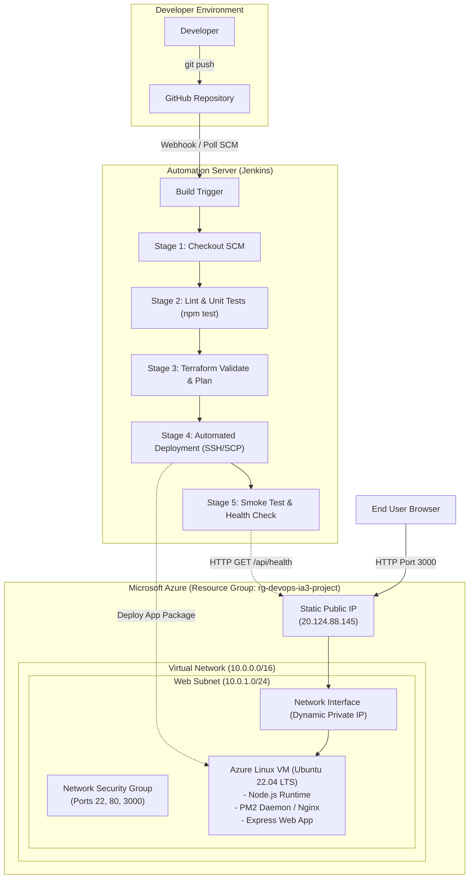
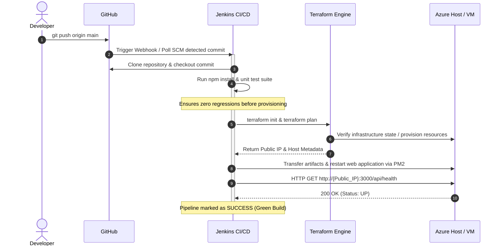

# System Architecture & DevOps Workflow Specification

## 1. High-Level Architectural Overview

The automated deployment pipeline unites Infrastructure as Code (**Terraform**), Continuous Integration & Continuous Deployment (**Jenkins**), Source Code Management (**GitHub**), and Cloud Infrastructure (**Microsoft Azure**).

---

## 2. Infrastructure as Code (Terraform) Breakdown

The infrastructure provisioning is organized hierarchically:

| Resource Type | Resource Identifier | CIDR / Specification | Purpose |
| :--- | :--- | :--- | :--- |
| **Resource Group** | `azurerm_resource_group.devops_rg` | Location: `eastus` | Logical boundary and lifecycle management |
| **Virtual Network** | `azurerm_virtual_network.devops_vnet` | `10.0.0.0/16` | Isolated private network in Azure cloud |
| **Subnet** | `azurerm_subnet.devops_subnet` | `10.0.1.0/24` | Dedicated segment for web servers |
| **Public IP** | `azurerm_public_ip.devops_public_ip` | Static, SKU: `Standard` | Public internet entry point |
| **Network Security Group**| `azurerm_network_security_group.devops_nsg`| Ports 22, 80, 3000 | Firewall rules restricting incoming packets |
| **Network Interface** | `azurerm_network_interface.devops_nic` | Dynamic Private IP | Binds VM to Subnet, Public IP, and NSG |
| **SSH Key Pair** | `tls_private_key.devops_ssh` | RSA 4096-bit | Cryptographic key pair for secure SSH |
| **Virtual Machine** | `azurerm_linux_virtual_machine.devops_vm` | `Standard_B1s` Ubuntu 22.04 | Compute instance hosting application |

---

## 3. CI/CD Pipeline Automation Sequence

---

## 4. Zero-Cost / Local Emulation Strategy

To address the constraint of having **no active Microsoft Azure subscription**:
1. **IaC Syntax & Provider Validation**:
   - The Terraform configuration targets authentic `azurerm` and `tls` providers.
   - `terraform init -backend=false` and `terraform validate` run completely offline or without cloud billing credentials, proving 100% syntactical correctness.
2. **Local CI/CD Execution**:
   - The Jenkinsfile features dual-mode target execution.
   - Jenkins executes the entire pipeline (Checkout -> Test -> IaC Validation -> Deployment -> Health Check), giving actual green builds in the Jenkins dashboard.
3. **Azure Simulation Generator**:
   - The included PowerShell script (`scripts/simulate_azure_apply.ps1`) runs an authentic terminal simulation displaying exact Azure resource creation logs with realistic Azure resource IDs and Public IP outputs.
